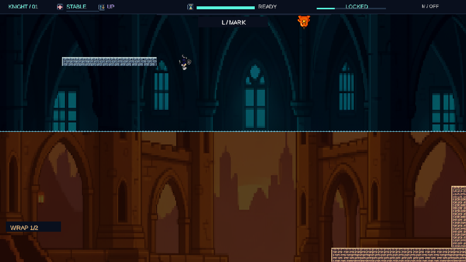
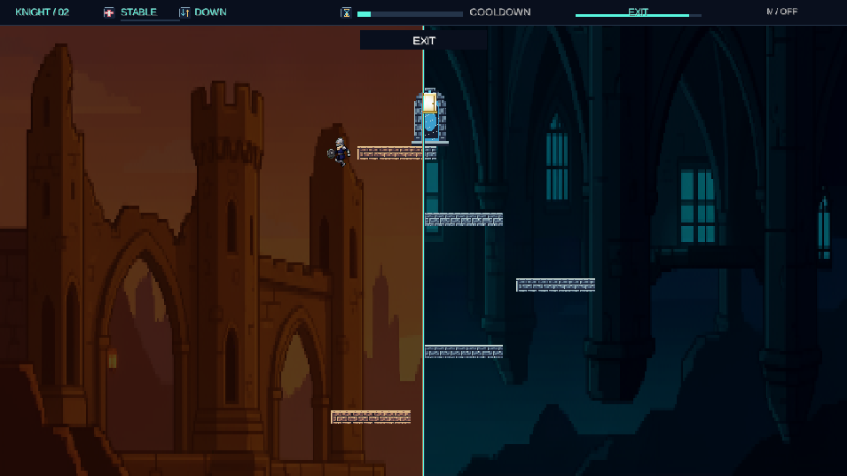
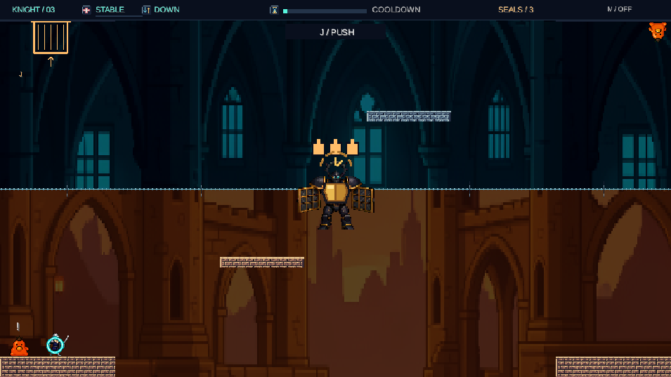
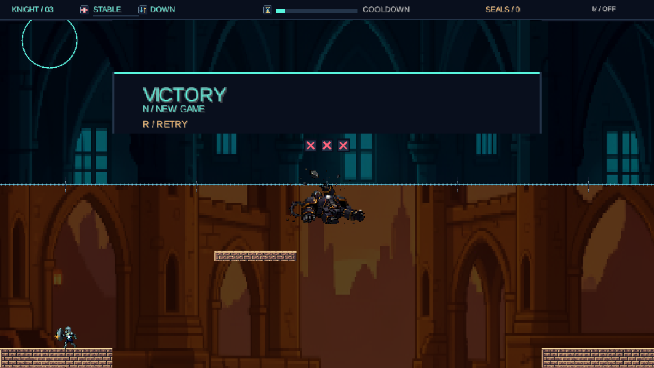

# KNIGHT / SLIMES — 2D 플랫포머 개발 레포트

**과목:** 게임 및 혼합현실  
**과제:** 중간 프로젝트 — LibGDX 2D 플랫포머  
**작성자:** 202321594 최익진  
**요구사항 기준:** `Term-2DGame.pptx` 3~7, 9~11번 슬라이드

> 시연 영상은 내일 녹화 후 유튜브 링크를 첨부할 예정입니다. 이 문서는 게임 구현과 검증을 설명하는 레포트이며, 발표자료는 별도로 작성합니다.

## 1. 프로젝트 개요

KNIGHT / SLIMES는 적을 단순히 제거하는 대신 **밀어내고, 복제하고, 발판과 퍼즐 재료로 활용하는** 2D 액션 퍼즐 플랫포머입니다. 플레이어는 근접 밀치기, 방어·저스트 패리, 시간 정지를 사용합니다. 월드 경계를 통과하면 다른 쪽으로 이어지며, 상하 경계에서는 중력이 반전됩니다.

진행은 가로 탐색, 세로 등반, 한 화면 보스전으로 구성됩니다. 보스전에서는 시간 정지로 무작위 목표를 표시하고, 시간이 풀린 뒤 일반 공격으로 분신을 목표에 보내 보스를 노출시킨 다음 저스트 패리로 봉인을 하나씩 파괴합니다.

## 2. 요구사항 및 배점 기준 대응

아래 비율은 과제 안내자료의 평가 비중입니다. 자체적으로 점수를 부여한 결과는 아닙니다.

| 평가 항목 | 안내자료 비중 | 구현 내용 | 확인할 자료 |
|---|---:|---|---|
| A. 서로 다른 레벨 3개 이상 | 15% | 가로 진행, 세로 등반, 사방 순환 보스방. 지형과 적 구성·목표가 다름 | 3개 레벨 지도, 대표 화면, 연속 진행 검사 |
| B. 조작에 따른 카메라 이동 | 10% | 1스테이지 수평 추적, 2스테이지 수직 추적 | 카메라 추적·클램프 코드와 그래픽 검사 |
| C. 코드로 구현한 독창적 요소 3개 이상 | 40% | 중력·운동량 순환, 원본/분신/시체 활용, 시간 정지 표적 퍼즐, 패리·봉인 전투 | 4~5절의 규칙과 구현 근거 |
| D. 일시정지와 재개 | 5% | Esc로 물리·공격·타이머·애니메이션 정지 및 재개 | 모델 검사, 일시정지 화면 |
| 구현의 적절성과 수준 | 20% | 120Hz 고정 시뮬레이션, 모델/렌더러 분리, 상태 기반 애니메이션, 입력 재현 검사 | 6절의 구조와 8절의 검증 |
| 게임 디자인 | 10% | 적을 위험과 이동 재료로 동시에 사용하고, 스테이지마다 익힌 규칙을 다른 방향으로 적용 | 7절의 의도와 스테이지 구성 |

## 3. 세 스테이지와 진행 방식

| 구분 | 1 — Boundary Foundry | 2 — Lateral Ascent | 3 — Paradox Warden |
|---|---|---|---|
| 월드 크기 | 4200×720 | 1280×2560 | 1280×720 |
| 진행 | 왼쪽에서 오른쪽으로 이동 | 아래에서 정상으로 등반 | 한 화면 보스 공략 |
| 연결 경계 | 위 ↔ 아래 | 왼쪽 ↔ 오른쪽 | 상하·좌우 모두 |
| 중력 | 상하 통과 시 반전 | 좌우 통과 시 유지 | 상하는 반전, 좌우는 유지 |
| 적·오브젝트 구성 | 근접 원본, 원거리 원본, 분신, 벽돌 | 계단과 높은 선반, 근접 원본과 분신 발판 | 바닥·천장 원본, 분신, 무작위 표적, 별도 보스 |
| 카메라·색상 | 수평 추적, 아래 warm/위 cool | 수직 추적, 왼쪽 warm/오른쪽 cool | 한 화면 고정, 아래 warm/위 cool |
| 완료 조건 | 분신 표적 전달로 출구를 열고 도착 | 분신 전달 후 높은 단차를 넘어 정상 출구 도착 | 새 표적 전달과 저스트 패리로 세 봉인 파괴 |

각 레벨은 맵의 방향·구조뿐 아니라 적 구성과 목표에서도 차이가 납니다. 특히 1스테이지의 원거리 적은 2스테이지의 단차 이동 문제와 다르고, 3스테이지는 전용 보스와 봉인 상태를 가진 전투 퍼즐입니다. 따라서 단순 배경 교체만으로 스테이지를 구분하지 않았습니다.

스테이지 클리어 화면에서 Enter로 다음 단계로 이동합니다. 최종 보스를 처치하면 VICTORY를 표시합니다. 최종 승리 후에는 N으로 1스테이지부터 새 게임을 시작하며, R은 현재 스테이지 재도전용으로 구분합니다.

### 카메라 구현

`OrthographicCamera`와 `FitViewport(1280,720)`를 사용합니다. 1스테이지는 플레이어의 가로 이동을, 2스테이지는 세로 이동을 따라가며 월드 밖을 비추지 않도록 각 축을 제한합니다. 위치는 픽셀 단위로 맞춰 작은 흔들림을 줄였습니다. 3스테이지는 화면 전체가 보스방이므로 카메라를 고정합니다.

구현 근거: `StageRenderer.render()`, `PixelAssets.follow()`, `StageOneLevel`, `StageTwoLevel`, `StageThreeLevel`.

## 4. 독창적 요소의 규칙과 구현

### 4.1 경계 순환·중력 반전·운동량 보존

상하 경계를 통과하면 반대편으로 이동하며 중력이 반전됩니다. 속도의 방향과 크기는 보존하므로 낙하가 재진입 후의 제동과 반동으로 이어집니다. 역중력에서는 천장이 착지면이 되고 점프 방향도 뒤집힙니다. 좌우 순환은 높이와 중력을 유지합니다.

착지 없이 경계를 연속 두 번 통과하면 사망합니다. 바닥·천장·분신·시체의 실제 지지면에 닿아야 횟수가 초기화됩니다. 포털 도착 위치 보정 자체를 착지로 간주하지 않도록 했습니다. 좌우 수신 지형에 조금 겹쳤을 때는 위치만 보정하고, 다음 실제 충돌이 속도와 연속 횟수를 처리합니다.

**의도한 재미:** 낭떠러지를 단순 사망 구역이 아니라 반대편 면으로 이동하는 경로로 사용하면서, 무한 낙하에는 위험을 부여했습니다.

구현 근거: `StageModel.physics()`, `resolveHorizontalEntry()`, `resolveEntry()`, `hasContactSupport()`.

### 4.2 원본·분신·시체를 이동 재료로 활용

살아 있는 원본을 경계 밖으로 밀면 원본은 초기 위치로 복귀하고 반대편에 분신을 하나 생성합니다. 같은 원본의 새 분신은 이전 분신을 대체하며, 분신은 다시 복제되지 않습니다. 원본은 순찰하고 분신은 플레이어를 추적합니다.

분신은 발판으로 사용할 수 있습니다. 원본을 저스트 패리로 처치하면 낮은 벽돌 시체가 남아 단차 이동에 활용됩니다. 시체를 밀어 경계로 보내면 부활시킬 수 있습니다. 살아 있는 원본을 밟으면 시간 정지가 풀리고 빠른 상단 공격이 나와, 원본과 분신의 용도를 구분해야 합니다.

**의도한 재미:** 적을 바로 처치하는 것이 언제나 유리하지 않게 했습니다. 분신 공급원과 이동 발판을 보존할지, 위험한 적을 벽돌로 바꿀지 선택하게 합니다.

구현 근거: `StageModel.handleEnemyBoundaries()`, `updateMovement()`, `triggerOriginalSupport()`, `solids()`.

### 4.3 시간 정지와 표적 전달 퍼즐

L은 플레이어를 제외한 세계를 3초간 멈춥니다. 적의 이동·공격 진행과 세계 애니메이션은 정지하지만 이미 활성화된 공격 판정은 위험합니다. 정지 중에는 적을 밀거나 처치하거나 패리할 수 없습니다. 종료 후에는 4초 쿨다운이 있습니다.

1·2스테이지의 표적은 정지 중에만 보여 위치를 기억해야 합니다. 해제 후 살아 있는 분신을 지지면의 목표로 유도하면 출구가 열립니다. 문 개방은 분신이 다시 떠나도 유지됩니다.

보스방에서는 표적을 확인한 뒤 **시간이 풀린 상태의 새 J 적중**으로 분신을 목표에 보내야 합니다. AI 추적만으로 지나가거나 정지 중에 누른 공격이 나중에 풀리는 것은 성공으로 처리하지 않습니다. 표적 생성 세대와 실제 공격 적중을 연결해 이전 봉인의 공격 판정이 다음 표적에 재사용되지 않도록 했습니다.

**의도한 재미:** 정지를 전투 회피뿐 아니라 다음 행동을 준비하고 목표 위치를 파악하는 도구로 사용하게 했습니다.

구현 근거: `StageModel.selectEchoTarget()`, `selectBossTarget()`, `updateEchoTarget()`, `targetVersion`과 분신의 공격 세대 기록.

### 4.4 밀치기·유지 방어·저스트 패리

J는 피해를 주는 공격이 아니라 위치를 바꾸는 밀치기입니다. K를 누르고 있으면 일반 방어가 유지되고, 최초 입력 직후 0.08초에 맞춘 반격은 저스트 패리입니다. 계속 누르고 있다고 저스트 판정이 반복되지는 않습니다.

일반 패리는 적을 기절시키고, 저스트 패리는 적을 처치합니다. 플레이어에게 HP 막대 대신 부상 상태를 사용했습니다. 첫 유효 타격 후 5초 안에 다시 맞으면 사망하며, 저스트 성공은 부상을 지우고 짧은 무적을 줍니다. 같은 틱에 여러 공격이 겹쳐도 성공한 패리를 피해 처리보다 먼저 해결합니다.

원거리 슬라임은 전조 후 수평 직선 전체를 즉시 타격합니다. 탄환은 생성하지 않으며 정적 벽과 월드 끝에서 공격이 잘립니다.

구현 근거: `StageModel.step()`, `updateAttack()`, `attackBox()`, `WOUND_DURATION`, `JUST_WINDOW`.

## 5. 최종 보스의 봉인 퍼즐

1. 바닥 또는 천장의 원본을 밀어 분신을 만듭니다.
2. L로 도달 가능한 지지면의 무작위 표적을 표시합니다. 보스방의 목표는 해제 뒤에도 남습니다.
3. 시간이 풀리면 J로 살아 있는 분신을 목표 안에 밀어 넣습니다. 목표 안에 이미 들어온 분신도 새 J가 적중하면 인정합니다.
4. 보스가 노출되면 광선에 새 저스트 패리를 맞춰 봉인 하나를 파괴합니다.
5. 다음 봉인은 새 표적과 새 전달이 필요합니다. 세 봉인을 모두 파괴하면 승리합니다.

목표의 표시와 실제 판정은 동일한 64×60 사각형을 사용합니다. 황색 미완료, 청록색 완료 상태와 열린 코어를 구분하고, 봉인 개수·공격 차지 바·짧은 L/J/K 안내만 화면에 남겼습니다. 노출은 봉인을 파괴할 때까지 유지됩니다.

## 6. 구현 구조와 동작의 적절성

| 구성 | 역할 |
|---|---|
| `StageModel` | LibGDX에 의존하지 않는 물리·충돌·전투·적·표적·진행 상태 |
| `StageOneLevel` / `StageTwoLevel` / `StageThreeLevel` | 지형과 적 배치 |
| `StageRenderer` | 입력, 120Hz 고정 틱 전달, 카메라, 스프라이트, HUD·메뉴 |
| `PixelAssets` | manifest 기반 이미지 로딩, 고정 앵커, 상태별 프레임과 팔레트 |
| `GameAudio` | 모델 이벤트를 소비하는 효과음 처리 |
| 검사 코드 | 개별 규칙, 정상 입력 경로, 같은 입력의 새 모델 재생, 전체 캠페인 비교 |

화면 프레임 속도와 규칙 진행을 분리하기 위해 1/120초 고정 틱을 사용했습니다. 입력의 눌림과 유지 상태를 구분해 한 프레임에 여러 틱이 처리되어도 방어가 끊기거나 새 저스트 입력이 반복되지 않도록 했습니다.

기사 공격은 효과선만 회전시키는 대신 팔과 검이 움직이는 8프레임 시트를 사용합니다. 0.28초 동작 중 0.07초 선행 동작 뒤에 밀치기를 한 번 적용해 시각 동작과 판정을 맞췄습니다. 몸통·발의 기준점과 유지 방어 자세를 고정해 프레임 간 흔들림을 줄였습니다.

보스는 보호·노출·충전·공격·파손·붕괴의 전용 이미지를 사용합니다. 효과음은 그리기 함수가 아니라 모델 이벤트에서 한 번씩 소비합니다. 이미지·효과음의 처리와 출처 정보는 `docs/ASSET_BRIEF.md`, `docs/BOSS_ART.md` 등에서 별도로 관리합니다.

원본 이미지별 사용 조건을 모두 확인한 상태는 아니므로 공개 재배포·상업적 사용 권한을 보증하지 않습니다. 생성 도구 출력과 원본·처리 기록을 구분한 [에셋 출처와 사용 범위](ASSET_SOURCES.md)를 함께 보관했습니다.

## 7. 게임 디자인 의도

기본 조작을 반복해서 다른 문제에 적용하는 구성을 의도했습니다. 1스테이지에서는 낙하와 중력 반전, 적을 이동 재료로 보는 법을 익힙니다. 2스테이지에서는 좌우 연결을 세로 등반에 적용합니다. 마지막에는 표적 확인·분신 밀치기·공격 전조 읽기를 한 전투에 결합합니다.

일반 공격은 위치 조절, 일반 방어는 안전 확보, 저스트 패리는 처치와 회복이라는 다른 역할을 가집니다. 따라서 공격 연타보다 공간 정리와 적 행동 유도가 중요해집니다. 작은 성공은 분신 생성과 문 개방, 큰 성공은 저스트 패리와 봉인 파괴로 피드백을 구분했습니다.

의도한 재미와 실제 난이도 평가는 구분합니다. 자동 입력 완주는 규칙상 도달 가능함을 확인하는 검사이지, 처음 플레이하는 사람에게 적정 난이도라는 증명은 아닙니다.

## 8. 최종 검증

| 검사 | 실제 확인 결과 |
|---|---|
| 순수 게임 모델 | 792개 규칙 검사 통과 |
| 표적·문 조건 | 738개 검사 통과 |
| 보스 경로·캠페인 | 27개 검사 통과. 실제 입력만으로 세 봉인 파괴·최종 승리·전체 새 게임 확인 |
| 시드와 상하 원본 경로 | 12개 시드 × 하단/상단의 24개 연속 캠페인 통과. 새 모델에 동일 입력을 재생해 전체 상태와 이벤트 일치 |
| 그래픽·UI 연결 | 자산/화면 연결 14개, 어댑터 18개, 간소 UI 2개, 검 동작 3개, 보스 아트 7개 통과 |
| 실행기 이식성 | 개인용 설정이 없는 상태의 Windows 실행기 3개 검사 통과. 실제 실행 배치도 1·2·3단계 각각 확인 |
| 빌드 | 로컬 JDK 17 및 Gradle Wrapper로 오프라인 `core:check`, `lwjgl3:classes`, `lwjgl3:jar` 성공 |
| 배포 리소스 | JAR 내부 런타임 에셋 55개, 인덱스/바이트/manifest 참조 일치, 원본·미리보기·proof 유출 0개 |
| 배포 JAR 실행 | 실제 OpenGL 프레임 생성, 이미지 18개·효과음 30개 로드, 누락 0개 확인 |

자동 입력 경로는 1스테이지 2720틱, 2스테이지 2261틱, 보스전 대표 경로 2674틱입니다. 이는 조작을 기다리지 않는 기록 입력의 길이이며 초보자의 예상 플레이 시간은 아닙니다. 실제 키보드와 대응하는 pressed/held 입력, 해제 후 재입력, 정상 클리어 후 Enter 전환을 사용했습니다. 검사 중 좌표·무적·적 제거·승리 상태를 주입하는 방식으로 전체 경로를 통과시키지 않았습니다.

### 대표 화면

다음 이미지는 검증용 장면 배치에서 **실제 게임 렌더러가 출력한 프레임**입니다. 레터박스 여백만 제외했습니다. 장면 설정 이미지는 수동 플레이나 전체 완주의 증거와 구분하며, 입력 전용 완주와 최종 새 게임은 위 모델 검사로 별도 확인했습니다.

1스테이지의 상하 팔레트와 역중력 장면입니다. 이 장면에서 카메라 X는 1250입니다.

2스테이지의 좌우 팔레트, 높은 지형과 열린 출구입니다. 카메라 Y는 2200이며, 실제 J 전달 판정으로 출구가 열린 뒤 정상부의 카메라 확인 위치에 배치해 표시했습니다.

보스방에는 바닥과 천장의 원본, 세 봉인, 노란 목표 영역이 함께 표시됩니다.

VICTORY로 전체 클리어를 알리고 N / NEW GAME과 R / RETRY를 구분합니다. 마지막 봉인 판정과 전체 캠페인 새 게임은 별도 입력 경로 검사에서도 확인했습니다.

## 9. 실행 및 현장 데모 준비

- Windows에서 `Play-Stage1.bat`로 시작합니다. `Play-Stage2.bat`, `Play-Stage3.bat`는 각 단계의 직접 확인용입니다.
- 프로젝트 로컬 JDK 설정이 있으면 사용하고, 없으면 Gradle Wrapper가 설치된 Java를 사용합니다. 새 환경에는 **JDK 17**이 필요합니다.
- 첫 의존성 다운로드에는 인터넷이 필요할 수 있으므로 현장 전에 빌드와 실행을 끝내 둡니다. 검증된 배포 JAR은 `lwjgl3/build/libs/Project2-1.0.0.jar`입니다.
- 기본 창은 1280×720이며 비율이 다르면 레터박스를 적용합니다. 이동 A/D·방향키, 점프 Space, 밀치기 J, 패리 K, 시간 정지 L, 일시정지 Esc, 재도전 R입니다.
- 다른 PC에서의 직접 플레이·음량·입력 장치 점검은 현장 준비 과정에서 추가 확인해야 합니다. 자동 그래픽 검사는 음소거로 수행합니다.

## 10. 제출 현황과 남은 항목

- 게임 구현 및 소스: 위 최종 검사와 실행 확인 완료.
- GitHub 소스: https://github.com/seorune/knight-slimes (비공개). 제출 전 채점자의 접근 권한 확인이 필요합니다.
- 레포트: 이 문서. 노션 원본과 함께 Git 저장소에 Markdown 사본을 보관합니다.
- 시연 영상: 내일 녹화 후 유튜브 업로드·링크 첨부 필요. 아직 첨부하지 않았습니다.
- 발표자료: 작성자가 내일 별도 제작합니다. 안내자료 기준 2분 이내입니다.
- LMS 제출: 레포트·발표자료·영상 링크·GitHub 링크를 제출 전에 확인해야 합니다. 이 작업에서 LMS 제출은 수행하지 않았습니다.

안내자료 11번 슬라이드는 11월 9일까지 발표자료·GitHub 링크 제출, 11월 10일 개인 발표를 명시합니다. 실제 마감은 최종 수업 공지와 함께 확인해야 합니다. 본 레포트는 요구사항을 설명하는 자료이며, 점수나 모든 예외 상황의 무결함을 보장하지 않습니다.
